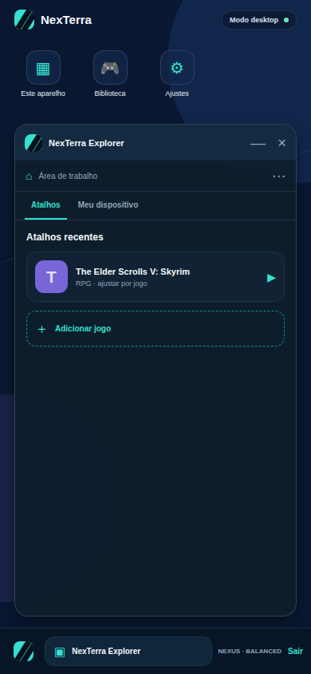
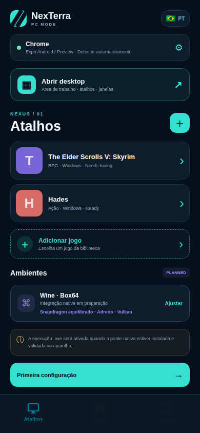

<div align="center">
  
  <h1>NexTerra Mobile</h1>
  <p><strong>Um desktop Windows portátil no Android, com runtime nativo real em evolução.</strong></p>
  <p>Wine · Box64/Box86 · FEXCore · DXVK · VKD3D · Mesa · Containers · Atalhos por jogo</p>

  <p>
    <a href="https://github.com/Arthur1010885/window-Mobile/stargazers"></a>
    <a href="https://github.com/Arthur1010885/window-Mobile/actions"></a>
    <a href="https://github.com/Arthur1010885/window-Mobile/blob/main/LICENSE"></a>
  </p>

  <p>
    <a href="https://github.com/Arthur1010885/window-Mobile/tree/native-runtime">Runtime Android nativo</a> ·
    <a href="https://github.com/Arthur1010885/window-Mobile/actions">Builds e APK</a> ·
    <a href="https://github.com/Arthur1010885/window-Mobile/issues">Issues</a> ·
    <a href="CHANGELOG.md">Changelog</a>
  </p>
</div>

<p align="center">
  
  
</p>

> **Meta pública:** chegar a 1.000 estrelas construindo uma camada Android aberta, transparente e respeitosa com as licenças de Wine, Mesa, Box64, DXVK e todos os componentes distribuídos.

## O que é o NexTerra

O NexTerra é um launcher de modo PC para Android. A experiência começa com uma área de trabalho própria, atalhos de jogos e uma biblioteca simples. A branch `main` contém a interface Expo/React Native e o protótipo navegável. A branch [`native-runtime`](https://github.com/Arthur1010885/window-Mobile/tree/native-runtime) contém a adaptação Android/NDK baseada em Winlator Bionic/Ludashi, com a camada real de compatibilidade Windows.

O objetivo não é fingir que um `.exe` funciona em qualquer aparelho. O objetivo é combinar uma interface bonita com diagnósticos honestos, perfis por hardware, containers isolados, configuração por jogo e um runtime que possa ser medido em aparelhos reais.

## Experiência

- **Modo desktop:** wallpaper próprio, atalhos, janela NexTerra Explorer, menu iniciar, barra de tarefas e acesso rápido à biblioteca.
- **Atalhos por jogo:** cada jogo pode ter seu próprio container, driver, preset Box64/FEX, resolução, controles e argumentos.
- **Perfis de hardware:** presets separados para Snapdragon/Adreno e MediaTek/Mali, com Vulkan/OpenGL ES e explicação do impacto.
- **Biblioteca enxuta:** favoritos, busca, categoria, estado de compatibilidade e caminho preparado para executáveis autorizados pelo usuário.
- **Runtime nativo:** Wine, Box64/Box86, FEXCore, DXVK, VKD3D, PulseAudio, XServer e componentes gráficos Android na branch nativa.
- **Transparência:** nenhuma promessa universal de FPS, nenhum jogo, BIOS, DLL ou conteúdo proprietário distribuído pelo projeto.

## Estrutura das branches

| Branch | Função | Estado |
| --- | --- | --- |
| [`main`](https://github.com/Arthur1010885/window-Mobile/tree/main) | Interface Expo, modo desktop, biblioteca, setup e documentação | Preview funcional |
| [`native-runtime`](https://github.com/Arthur1010885/window-Mobile/tree/native-runtime) | Android/Gradle/NDK adaptado de Winlator Bionic/Ludashi | Build arm64-v8a no GitHub Actions |

A separação é intencional. A UI pode evoluir sem quebrar o runtime nativo, e o runtime pode ser testado com Gradle/NDK sem transformar o protótipo Expo em uma promessa falsa de emulação.

## APK nativo

O workflow [Android CI Bionic](https://github.com/Arthur1010885/window-Mobile/actions/workflows/build.yml) gera o APK da branch `native-runtime` com JDK 17, Android SDK, NDK e dependências nativas. Abra a execução mais recente em **Actions → Android CI Bionic → Artifacts** para baixar o artefato `NexTerra-Native-*`.

O APK nativo é arm64-v8a. A compatibilidade depende do Android, SoC, GPU, driver Vulkan, memória, temperatura e do jogo. A branch nativa usa o kernel Android real do aparelho; um APK não instala um kernel próprio. Kernel customizado é uma imagem de boot/ROM específica por dispositivo e fica fora do escopo de um aplicativo comum.

## Começar pela interface

```bash
pnpm install
pnpm db:push
pnpm dev
```

O Preview usa Metro na porta `8081` e a API do starter na porta `3000`. Abra a home e toque em **Abrir desktop** para entrar na área de trabalho NexTerra.

## Base nativa e licenças

A base Android nativa foi adaptada de [`StevenMXZ/Winlator-Ludashi`](https://github.com/StevenMXZ/Winlator-Ludashi). O projeto upstream documenta containers x86_64 com Box86/Box64 e Arm64EC com FEXCore, além de componentes como DXVK, VKD3D, Mesa/Turnip e PulseAudio. A camada do projeto e os componentes empacotados podem ter licenças diferentes; consulte os avisos dentro da branch e preserve atribuição antes de redistribuir builds.

Referências técnicas avaliadas:

- [`brunodev85/winlator`](https://github.com/brunodev85/winlator) — referência original Android/Wine/Box86/Box64.
- [`StevenMXZ/Winlator-Ludashi`](https://github.com/StevenMXZ/Winlator-Ludashi) — base escolhida para o runtime nativo.
- [`RemiPelloux/OpenNative`](https://github.com/RemiPelloux/OpenNative) — alternativa GPL-3.0 com runtime Android mais amplo.
- [`nihui/mesa-turnip-android-driver`](https://github.com/nihui/mesa-turnip-android-driver) — referência de Turnip para GPUs Adreno.

Leia a decisão completa em [`docs/native-runtime-migration.md`](docs/native-runtime-migration.md) e a referência de UI em [`docs/ui-references.md`](docs/ui-references.md).

## Roadmap público

- [x] Launcher simples com atalhos e biblioteca.
- [x] Modo desktop visual com janela, menu iniciar e barra de tarefas.
- [x] Presets Snapdragon/Adreno e MediaTek/Mali.
- [x] Branch Android nativa baseada em runtime real.
- [x] Build arm64-v8a via GitHub Actions.
- [ ] Validar APK nativo em aparelhos Snapdragon e MediaTek reais.
- [ ] Conectar a interface NexTerra ao runtime nativo sem remover containers, controles ou display.
- [ ] Adicionar diagnóstico nativo de CPU/GPU/RAM e thermal throttling.
- [ ] Publicar releases estáveis com checksums, notas de compatibilidade e logs sanitizados.
- [ ] Alcançar 1.000 estrelas com contribuições, testes reproduzíveis e documentação aberta.

## Contribua

Quer ajudar a chegar à primeira 1K? Dê uma estrela, abra uma issue com aparelho/Android/SoC/GPU/driver/jogo/configuração, teste apenas software que você possui ou está autorizado a executar e envie PRs pequenos com evidência. Relatórios de performance precisam separar ganho medido de expectativa.

Não envie jogos, ROMs, BIOS, DLLs proprietárias, saves ou credenciais. Não abra issues com dados pessoais ou logs que revelem caminhos privados.

## English

NexTerra Mobile is an Android PC-mode launcher with a real native runtime branch. `main` contains the Expo/React Native UI prototype and desktop shell. [`native-runtime`](https://github.com/Arthur1010885/window-Mobile/tree/native-runtime) contains the Android/NDK adaptation based on Winlator Bionic/Ludashi, including Wine, Box64/Box86, FEXCore, DXVK, VKD3D, PulseAudio, containers and Android graphics components.

The project is intentionally honest about compatibility. The APK uses the device's real Android kernel and graphics stack; it does not install a universal Windows kernel. Compatibility varies by SoC, GPU, driver, Android version, thermal state and game.

**Road to 1K stars:** star the repository, test on hardware, report reproducible results and help us turn the runtime branch into a documented, measurable and respectful open-source Android experience.

## Status

**Native build:** GitHub Actions builds the arm64-v8a runtime branch. **`.exe` compatibility:** real runtime present in `native-runtime`, device validation still required. **Kernel:** Android kernel from the user's device, not bundled in the APK. **License:** preserve upstream and third-party notices before redistribution.
